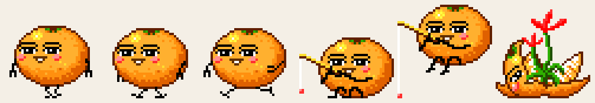
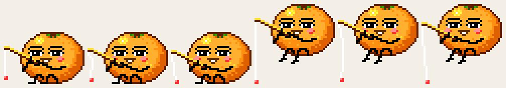
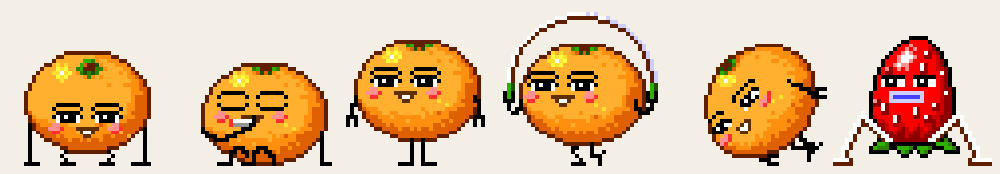
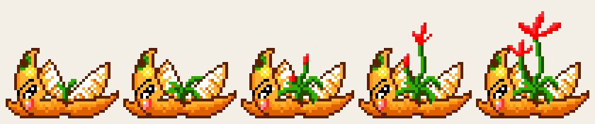

<meta charset="UTF-8">

# Orange



*Standing, a walk step, a run step, calm fishing, the flying cast, and the open flower.*

Orange is a Windows **screen mate**: a small layered pet that walks the desktop on its own. This repository is a native Win32 port of the original 16-bit `Orange.exe`. The sprite sheets and cries are the original resources. The desktop blit is a per-pixel layered window, the same approach as [Scmpoo](https://github.com/jakovradojevic/Scmpoo).

The two programs stay separate. They share one header, `src/mate_protocol.h`, and can see each other on the desktop.

---

## Usage

The orange drops onto the work area, then mostly walks and runs. A tick is 108 ms. Up to 8 instances can run at once.

- **Drag** with the left button to move it. Letting go returns it to idle.
- **Left double-click** — settings (gravity, sound, always active).
- **Ctrl+Shift+left double-click** — animation picker.
- **Right-click** — Settings, Animations, or Exit.
- **Right double-click** — exit.
- **Drop a `.wav`** on it to play that file.

Settings are stored in `scmate.ini` next to the executable.

**Gravity** drops it onto window tops and onto the desktop floor. **Sound On** plays the original cries. **Always Active** keeps the random picker from choosing sleep; Rest can still be played from the menu.

### Floor

Feet stand on the top of a taskbar that is docked to the bottom of that monitor. An auto-hiding taskbar, or a bar on the left, right, or top, does not raise the floor. The same helper lives in Scmpoo, so the sheep, the ball, and the orange agree about where the ground is.

### Run it with the sheep

Neither program asks for administrator. Window messages do not cross integrity levels, so start them the same way.

Test switches, not part of normal play:

- `Orange.exe --bloom` opens the flower immediately.
- `Orange.exe --fish` starts the flying cast next to the nearest sheep.

---

## What it does on its own

Walk and run still fill most of the random table, with Doze and Rest behind them. Every other gesture, including the flying cast, is in that table once. When the flower animation splits open, it stays that way until a sheep eats it. Rest is replaced by Doze when Always Active is on.

The menu names are the original `Orange.exe` list:

Run, Walk, Push-ups, Smoke, Doze, Rest, About face, Flip, Hoop, Read, Babble, Fish, Cry, Sit-ups, Peeled, Peeled slow, Flower, Spin, Drip, Calm, Skit, Smoke walk, Read hop, Saunter, Hop, Hoop walk, Fish tug, Hatch, Berries.



*Left three: calm fishing. Right three: the flying cast.*



*A still pose, a hand at the mouth, another still, headphones, a scowl, and the strawberry from Berries.*

It turns around at the edges of the work area, and when another mate is standing in front of the next step. Dropping a `.wav` also plays the surprise frames.

---

## With the sheep

The hidden director window (`ScreenMateDirector`) ticks every 500 ms. Both programs register with it. One director is shared, whoever creates it first.

### Toy, then flower

When no real ball is on screen and nobody is already blooming, an idle orange is occasionally told to stand as a toy. That roll is about once per minute and a half of eligible time. It stands for one minute. When the minute ends it blooms: the body splits and a flower grows (`107.bmp`). The flower holds for a little over a minute if nobody eats it, then the orange is itself again.



The nearest free sheep is asked to come and eat. It only accepts when it is interruptible and close in height. While it chews, the flower closes in reverse. After the meal the sheep's horns stay orange for about two minutes.

If a real ball appears during the toy minute, the toy ends at once and the orange blooms early. A ball also blocks a new toy from being chosen.

### Fishing

Calm fishing stands in place. Fish tug is the flying cast: the orange bobs up and down and travels sideways for about ten seconds. If a sheep is within 48 pixels horizontally and 64 vertically, it is hooked. Only one sheep is carried. The sheep hangs from the red bobber and plays the last two frames of its `103.bmp`, arms up. If the line would drop the sheep behind the taskbar, the orange holds altitude so the sheep's feet stay on the floor. At the end of the cast the sheep is let go.


### Ball, knock, and the hour

An idle orange sometimes chases the sheep's real ball (window title `Screen Mate Ball`) and kicks it. While it is the toy, a kick sends it flying and it plays the airborne cry frames until it settles. A knock from an alien sheep does the same kick when it is the toy, and a short flinch otherwise.

On the hour the director chimes every registered mate. An idle orange pauses and cries.

---

## Build from source

CMake ≥ 3.16. The target is `Orange`.

```bash
cmake -S . -B cmake-build-release
cmake --build cmake-build-release --target Orange
```

MinGW needs `windres` on `PATH` (the CLion MinGW `bin` directory is enough). The executable is `cmake-build-release/src/Orange.exe`.

## Credits

Sprite sheets, icon, and wave cries come from the original 16-bit Orange screen mate.

The sheep it plays with is [jakovradojevic/Scmpoo](https://github.com/jakovradojevic/Scmpoo), itself a fork of [lwu309/Scmpoo](https://github.com/lwu309/Scmpoo). The shared protocol header is copied in both trees and must stay identical.
